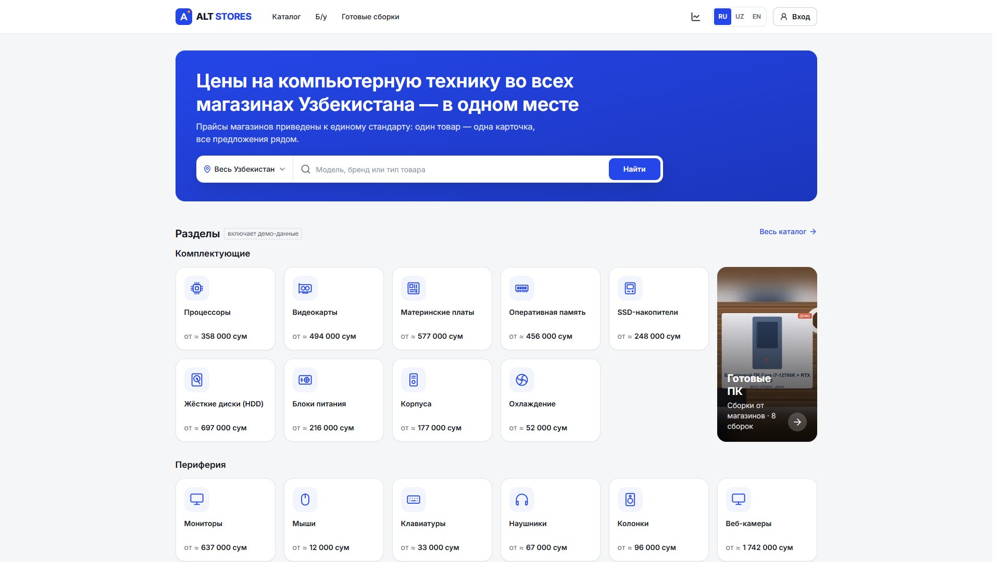

# ALT STORES

**Единая база компьютерной техники Узбекистана.** Магазины загружают прайсы в любом виде — Excel, CSV, PDF, посты из Telegram, — а система приводит их к одному стандарту: одна эталонная карточка товара и на ней предложения всех магазинов. Покупатель честно сравнивает цены и наличие, видит рыночную цену и предупреждения о подозрительных предложениях (Anti-Fraud); продавец ведёт остатки по филиалам вместо Excel.

> Дипломный проект «Разработка информационной системы мониторинга и стандартизации рынка компьютерной техники», 2026. Версия **v1.0**.
>
> **Сайт: https://pcmarket.khudoberdi.uz** (демо-магазины и реальный магазин Age Computers) · **Материалы диплома: [docs/diploma_index.md](docs/diploma_index.md)**



## Возможности

- **Прайс как есть:** Excel (объединённые ячейки, несколько таблиц), CSV в любой кодировке, PDF, посты Telegram на русском и узбекском; редактируемый предпросмотр перед публикацией, отмена загрузки.
- **Стандартизация:** кэш → правила → ИИ (Gemini, запасной Groq); цену, артикул и наличие берёт код, а не ИИ; код МХИК — из справочника tasnif.soliq.uz; один товар — одна карточка.
- **Anti-Fraud:** б/у под видом нового, противоречия в характеристиках, «флешки на 2 ТБ», цена сильно ниже рынка; сначала правила, ИИ — вторым слоем, продавец может оспорить.
- **Мониторинг рынка:** медианная цена, метки «ниже/выше рынка», графики, индексы категорий, архив цен 2022 года.
- **Покупателю:** каталог и поиск по характеристикам, города, б/у отдельно, готовые сборки, бронь без оплаты, чат с магазином, цены в сумах по курсу ЦБ.
- **Продавцу:** кабинет «Мои товары», филиалы и учёт остатков (приход, продажа, бронь, ревизия, журнал движений), склад, штрихкоды (USB-сканер и камера), Excel-импорт/экспорт, фото по стандарту, уведомления.
- **Администратору:** проверка и блокировка магазинов, жалобы, исправления карточек, модерация фото.
- **Три языка:** русский, узбекский (латиница), английский; вёрстка от телефона 360 px до ПК.

## Технологии

Python 3.12, FastAPI, SQLAlchemy, SQLite, JWT · React (Vite), Tailwind CSS, react-i18next, Chart.js · Google Gemini и Groq на бесплатных лимитах · pytest, Vitest, Playwright · Docker за nginx и Cloudflare.

## Как запустить локально (Windows)

Нужны Python 3.12+ и Node.js 20+.

```powershell
cd backend
python -m venv .venv
.\.venv\Scripts\python.exe -m pip install -r requirements.txt
```

Создать `backend/.env` (в git не попадает): `JWT_SECRET=` — любая длинная случайная строка, `GEMINI_API_KEY=` ([AI Studio](https://aistudio.google.com/apikey)), `GROQ_API_KEY=` ([Groq](https://console.groq.com/keys)).

- `start.bat` — backend (http://127.0.0.1:8000/docs) и сайт (http://localhost:5173); `stop.bat` — остановить.
- `demo.bat` — демо-база с нуля за ≈ 40 с, без ИИ.
- Тесты: `cd backend` → `.\.venv\Scripts\python.exe -m pytest`; `cd frontend` → `npm test`; проверка сайта — `smoke.bat`.

## Документация

- [docs/diploma_index.md](docs/diploma_index.md) — указатель материалов диплома (презентация, эксперимент, тестирование, диаграммы, скриншоты)
- [docs/maintenance.md](docs/maintenance.md) — обслуживание: выкладка, копии базы, ключи ИИ, «что-то сломалось»
- [docs/deploy.md](docs/deploy.md) — устройство сервера и выкладки
- [docs/roadmap.md](docs/roadmap.md), [docs/history.md](docs/history.md) — план и история разработки
